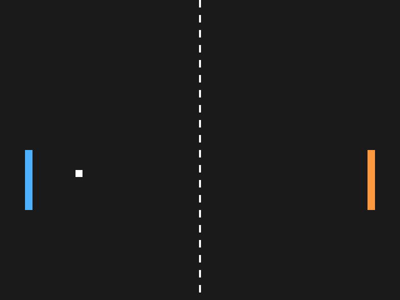

# Pong - LÖVE2D

**Yousef Shabib** | Student ID: **12217432**  
**Class / section:** To be added before submission.

A two-player Pong game made with Lua and LÖVE2D. Move the paddles to bounce the ball. The game uses delta time, wall and paddle collisions, and resets the ball after a miss.

## Run
Install [LÖVE 11.5](https://love2d.org/), then run `love .` in this folder or drag the folder onto the LÖVE app.

## Controls
- Left paddle: **W / S** (also works with an Arabic keyboard layout).
- Right paddle: **Up / Down arrows**.

## My change
The left paddle is blue and the right paddle is orange.

## Screenshot

## Demo
[Watch the gameplay demo](demo/pong-demo.mp4) (scripted keyboard input).

[Tutorial](https://www.youtube.com/watch?v=igQPL0Ali8M)
